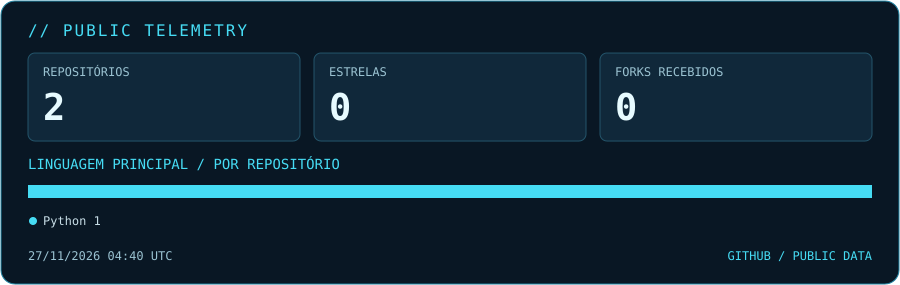

**INTELIGÊNCIA ARTIFICIAL · AUTOMAÇÃO · ENGENHARIA DE SOFTWARE**

`BUILD • TEST • REVIEW • EVOLVE`

[Repositórios públicos](https://github.com/juannunes544costaa-cmd?tab=repositories) · [Atividade](https://github.com/juannunes544costaa-cmd?tab=overview)

## ◈ 01 / Painel de telemetria

Dados de repositórios públicos próprios, incluindo este perfil após sua publicação; atualização diária via GitHub Actions. Forks são excluídos.

## ◈ 02 / Módulos de interesse

| Módulo | Foco |
| :-- | :-- |
| `AI / AGENTS` | Assistentes inteligentes e agentes de IA |
| `AUTOMATION` | Automação de processos e fluxos de trabalho |
| `SOFTWARE` | Desenvolvimento de aplicações e experimentos |
| `VERSION CONTROL` | Git, branches, testes e revisão de Pull Requests |

## ◈ 03 / Laboratório público

[**projeto-2**](https://github.com/juannunes544costaa-cmd/projeto-2) — repositório público de desenvolvimento.

## ◈ 04 / Protocolo de operação

`IDEIA → IMPLEMENTAÇÃO → TESTES → REVISÃO → EVOLUÇÃO`

---

**JARVIS // DEVELOPMENT INTERFACE**

Projetos privados permanecem fora deste painel.

