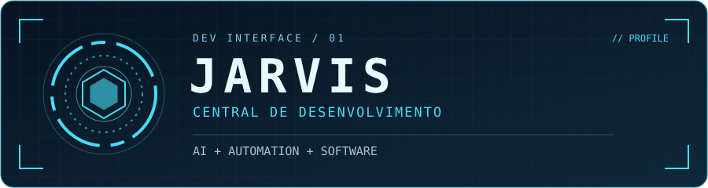
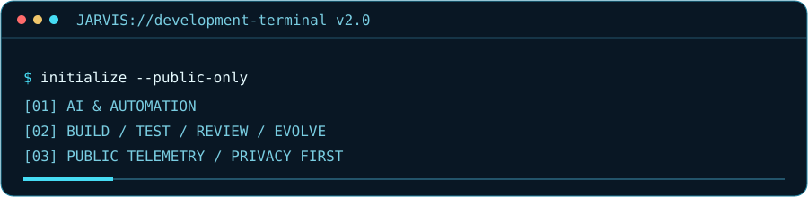
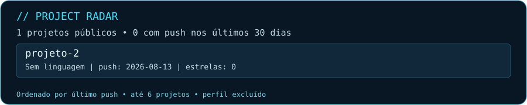
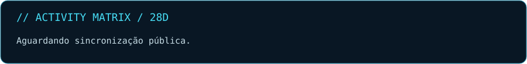

**JARVIS v2.0 // DEVELOPMENT INTERFACE**

[Repositórios públicos](https://github.com/juannunes544costaa-cmd?tab=repositories) · [Atividade](https://github.com/juannunes544costaa-cmd?tab=overview) · [Automação](https://github.com/juannunes544costaa-cmd/juannunes544costaa-cmd/actions)

## ◈ 01 / Terminal

## ◈ 02 / Telemetria pública

Repositórios públicos próprios, sem forks. Inclui o repositório do perfil; linguagens por repositório, não por volume de código.

## ◈ 03 / Radar de projetos

[Explorar repositórios públicos](https://github.com/juannunes544costaa-cmd?tab=repositories)

## ◈ 04 / Matriz de atividade

Amostra de até 300 eventos públicos recentes do titular em repositórios públicos próprios, excluindo este perfil. Eventos de push não são contagens de commits; não representa o gráfico de contribuições do GitHub.

## ◈ 05 / Módulos de interesse

| Módulo | Foco |
| :-- | :-- |
| `AI / AGENTS` | Assistentes e agentes de IA |
| `AUTOMATION` | Automação de processos |
| `SOFTWARE` | Desenvolvimento de aplicações |
| `VERSION CONTROL` | Git, testes e revisão de Pull Requests |

`BUILD • TEST • REVIEW • EVOLVE`

Dados públicos apenas. Atualização diária via GitHub Actions. Nenhuma credencial adicional. Animações SVG possuem conteúdo estático de reserva.

